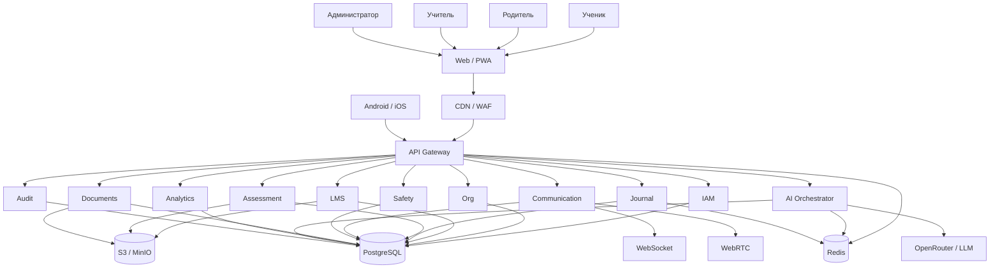

# Архитектура системы

| Параметр | Значение |
|---|---|
| Код документа | ШК-03-01 |
| Версия | 0.2 |
| Статус | Рабочий |
| Дата | 30.10.2026 |

## 1. Архитектурное решение
Принимается **микросервисная платформа в едином монорепозитории**. Каждый
функциональный домен оформляется как самостоятельный сервис с собственным
манифестом, API, правами и миграциями. На пилоте и в разработке сервисы
монтируются в общий FastAPI-шлюз; в промышленной эксплуатации любой сервис
запускается отдельным процессом/контейнером без переписывания бизнес-логики.

Ключевые принципы:

- API-first и версионированные контракты;
- права назначаются **группам пользователей**, а не отдельным пользователям;
- иерархия групп и наследование: класс → школа → город → область → страна;
- включение/отключение сервиса на любой области иерархии;
- клиент показывает только то, что включено и разрешено пользователю;
- асинхронные фоновые задачи и независимое масштабирование сервисов.

Детали — в ШК-03-04 (микросервисы) и ШК-03-05 (группы и права).

## 2. Логическая архитектура
### 2.1. Клиенты
- React SPA (web).
- PWA для школ и слабых устройств.
- Flutter Android.
- Flutter iOS.
- Административные веб-интерфейсы.

### 2.2. Входной слой
- WAF / Anti-DDoS.
- Reverse proxy (Nginx).
- API Gateway: маршрутизация, rate limiting, JWT, CORS, request tracing.
- SSO-адаптер (ЕСИ/РИОС — при наличии).

### 2.3. Прикладные домены (микросервисы)
1. **IAM** — пользователи, группы, иерархические права, сессии, согласия.
2. **Org** — регионы, города, школы, классы, иерархия.
3. **LMS** — предметы, темы, уроки, пособия, медиа, портфолио.
4. **Assessment** — тесты, вопросы, работы, ответы, проверки.
5. **Journal** — оценки, посещаемость, отчёты.
6. **Library** — библиотека, доступ классов, рекомендации.
7. **Communication** — чаты, уведомления, видео.
8. **Safety** — психологическая поддержка, геолокация, инциденты.
9. **Documents** — шаблоны, заявки, справки, подписи.
10. **Analytics** — BI, отчёты, выгрузки.
11. **AI Orchestrator** — генерация, проверка, RAG, валидация.
12. **Audit** — аудит действий и события безопасности.
13. **Admin** — глобальные настройки, языки, интеграции.

Каждый домен публикует манифест в `system.services`, права в
`iam.permissions` и может быть включён или отключён для любой области
иерархии через `system.service_activations`.

### 2.4. Группы и доступ
- Пользователь входит в одну или несколько групп.
- Группа принадлежит области (страна/область/город/школа/класс) и категории
  (ученики, учителя, администрация, методисты, психологи, секретариат,
  родители).
- Права выдаются группе с эффектом `allow`/`deny` и сроком действия.
- Наследование: явный родитель группы + организационные предки той же
  категории.
- Конфликты: побеждает более конкретная область; при равной глубине —
  `deny`.
- Клиент получает действующие права через `/api/v1/me/permissions` и
  доступные сервисы через `/api/v1/me/services`.

### 2.5. Данные
- PostgreSQL 16 — основная БД.
- Redis — кеш, сессии, очереди, rate limiting.
- S3/MinIO — файлы (PDF, фото, аудио, видео).
- pgvector — эмбеддинги нормативных документов и учебников.
- Поисковый индекс (OpenSearch/Meilisearch) — при росте контента.

### 2.6. Фоновые задачи
- Celery/RQ или Dramatiq.
- Очереди: AI, проверка файлов, уведомления, отчёты, синхронизация.
- Повторные попытки, dead-letter queue, мониторинг.

## 3. Компонентная схема

## 4. Потоки данных
### 4.1. Прохождение задания
1. Ученик открывает работу.
2. Клиент получает задание и локально кеширует.
3. Ответ отправляется в API.
4. Файл (фото/аудио) загружается в S3.
5. AI-сервис проверяет ответ, результат сохраняется.
6. Учитель подтверждает или корректирует оценку.
7. Обновляются журнал, прогресс и уведомления.

### 4.2. Офлайн-синхронизация
1. Клиент сохраняет операцию в локальную очередь с `operation_id`.
2. При появлении сети отправляет пакет на `/sync`.
3. Сервер проверяет идемпотентность по `operation_id` и `device_id`.
4. Конфликты разрешаются по правилам: оценки — сервер главный; прогресс —
   LWW; документы — версия сервера.
5. Клиент получает подтверждение и обновляет локальное состояние.

## 5. Безопасность архитектуры
- TLS 1.2+ на всех внешних соединениях.
- JWT access/refresh, ротация refresh.
- RBAC + tenant checks.
- PostgreSQL RLS для критичных таблиц.
- Шифрование чувствительных полей на уровне приложения.
- WAF, rate limiting, защита от OWASP Top 10.
- Аудит всех административных действий.
- Изоляция AI-запросов и запрет передачи лишних ПДн.

## 6. Масштабирование
- Stateless API за балансировщиком.
- Горизонтальное масштабирование API и воркеров.
- Реплики PostgreSQL для чтения.
- Redis Cluster при росте.
- CDN для статики и медиа.
- Очереди для пиковых нагрузок.
- Кеширование справочников и контента.

## 7. Отказоустойчивость
- Health checks и автоматический перезапуск.
- Circuit breaker для внешних сервисов.
- Очереди и повторные попытки.
- Graceful degradation: при недоступности AI задания работают без ИИ.
- Резервное копирование и проверка восстановления.

## 8. Технологический стек
| Слой | Технология |
|---|---|
| Backend | Python 3.12+, FastAPI, Pydantic v2 |
| ORM | SQLAlchemy 2.0 async, Alembic |
| БД | PostgreSQL 16+, pgvector |
| Кеш/очереди | Redis, Celery/Dramatiq |
| Web | React 18+, TypeScript, Vite, TailwindCSS |
| Mobile | Flutter, Hive/SQLite |
| Файлы | S3/MinIO |
| AI | OpenRouter, OpenAI-совместимые API |
| Мониторинг | Prometheus, Grafana, Loki, Sentry |
| CI/CD | GitLab CI/GitHub Actions, Docker |
| Хостинг | Alwaysdata (пилот), ЦОД РБ (промышленная эксплуатация) |

## 9. Ограничения
- Пилот на Alwaysdata не заменяет промышленный ЦОД.
- Для аттестации может потребоваться выделенная инфраструктура.
- Внешние AI-провайдеры требуют оценки рисков передачи данных.
- Государственные интеграции зависят от регламентов и API операторов.
