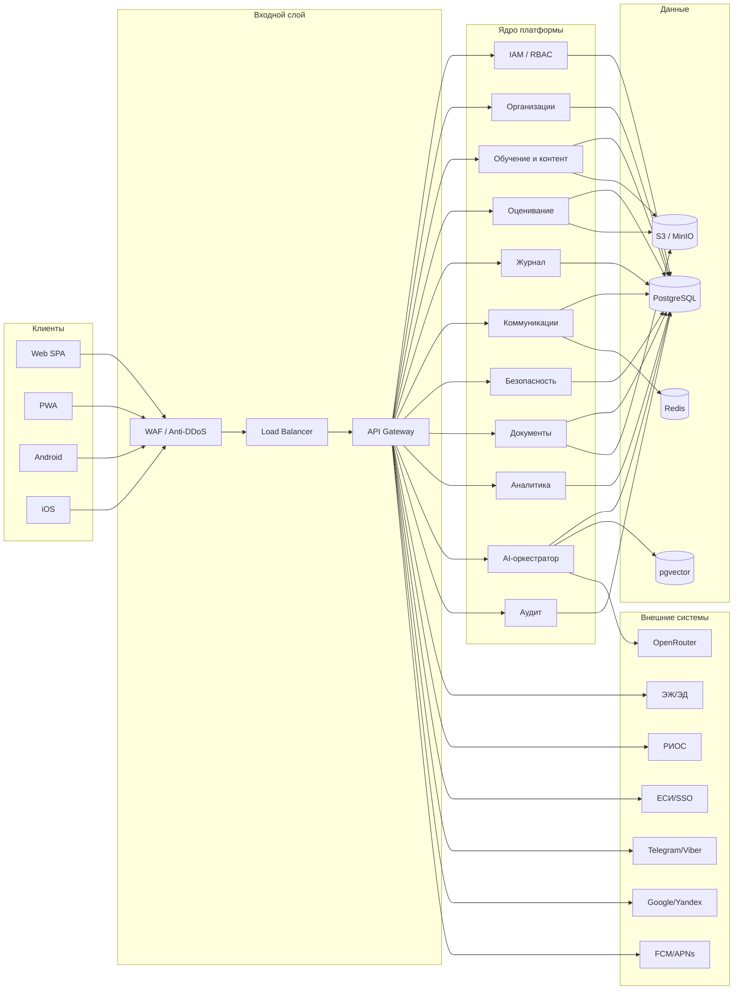
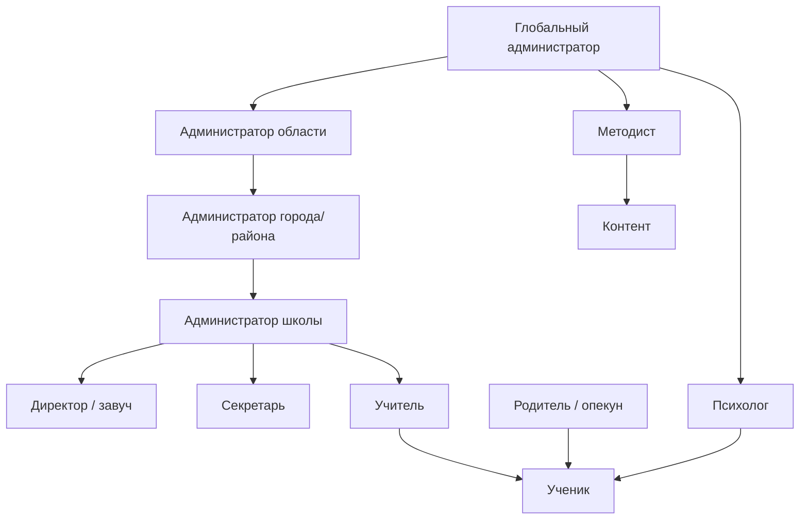
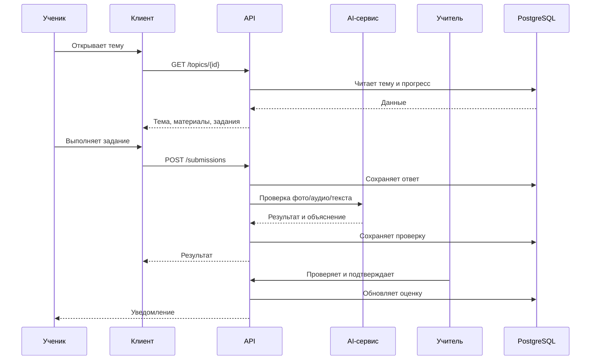
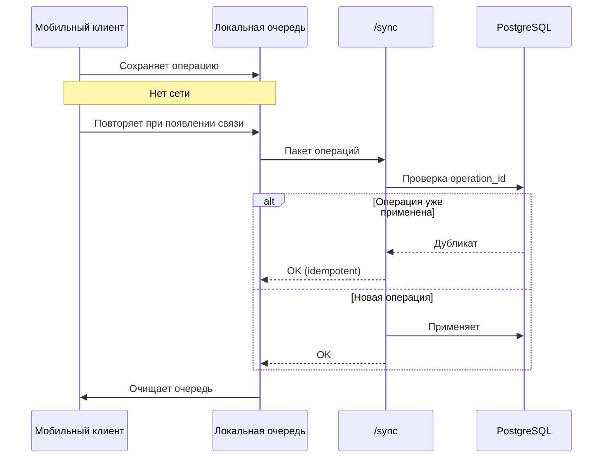
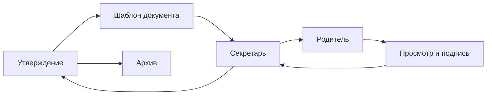

# Блок-схема платформы

| Параметр | Значение |
|---|---|
| Код документа | ШК-03-02 |
| Версия | 0.1 |
| Статус | Черновик |
| Дата | 27.10.2026 |

## 1. Верхнеуровневая блок-схема

## 2. Схема ролей и доступов

## 3. Схема учебного процесса

## 4. Схема офлайн-синхронизации

## 5. Схема документооборота

## 6. Пояснения
- Схемы являются логическими; физическая deployment-схема — в ШК-03-01.
- Внешние системы подключаются через адаптеры и могут быть отключены.
- Для промышленной эксплуатации предполагается размещение в ЦОД на
  территории Республики Беларусь.
