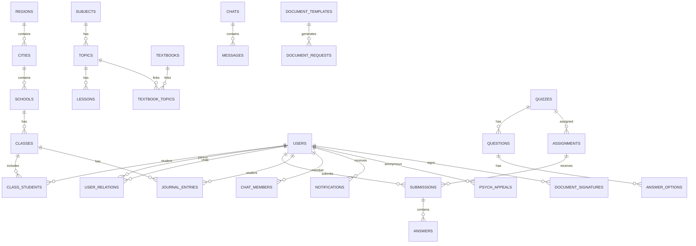

# Модель данных

| Параметр | Значение |
|---|---|
| Код документа | ШК-04-01 |
| Версия | 0.1 |
| Статус | Черновик |
| Дата | 27.10.2026 |

## 1. Общие принципы
- СУБД: PostgreSQL 16+.
- Первичные ключи: UUID (`gen_random_uuid()`), кроме справочников, где допустим
  BIGSERIAL.
- Временные метки: `created_at`, `updated_at` (timestamptz, UTC).
- Мягкое удаление: `deleted_at` для пользовательских сущностей.
- Версионирование: `version` (optimistic locking) для критичных записей.
- Мультитенантность: `school_id` в учебных данных; проверка на уровне API и RLS.
- Мультиязычность: JSONB `{"ru": "...", "by": "...", "en": "..."}`.
- Аудит: `created_by`, `updated_by`, отдельная таблица `audit.events`.
- Секреты и пароли: только хеши/шифротекст, никогда в открытом виде.

## 2. Схемы PostgreSQL
| Схема | Назначение |
|---|---|
| `iam` | Пользователи, роли, права, сессии, согласия |
| `org` | Регионы, города, школы, классы |
| `lms` | Предметы, темы, уроки, пособия, медиа |
| `assessment` | Тесты, вопросы, работы, ответы |
| `journal` | Оценки, посещаемость, отчёты |
| `communication` | Чаты, сообщения, уведомления, звонки |
| `safety` | Психология, геолокация, инциденты |
| `documents` | Шаблоны, заявки, справки, подписи |
| `analytics` | Агрегаты, отчёты, снимки |
| `ai` | Настройки, запросы, результаты, эмбеддинги |
| `audit` | Аудит действий и события ИБ |
| `system` | Справочники, настройки, языки, версии |

## 3. IAM
### 3.1. `iam.users`
| Поле | Тип | Описание |
|---|---|---|
| id | uuid PK | Идентификатор |
| login | citext unique | Логин |
| password_hash | text | Argon2id/bcrypt |
| role_id | uuid FK | Основная роль |
| school_id | uuid FK null | Школа |
| class_id | uuid FK null | Класс (для ученика) |
| first_name, last_name, patronymic | text | ФИО |
| email | citext null | E-mail |
| phone | text null | Телефон |
| avatar_url | text null | Аватар |
| language | text | ru/by/en |
| status | text | active/blocked/pending |
| parent_code | text unique null | Код привязки родителя |
| last_login_at | timestamptz null | Последний вход |
| created_at, updated_at, deleted_at | timestamptz | Служебные |

Индексы: `login`, `email`, `school_id`, `class_id`, `parent_code`.

### 3.2. `iam.roles`, `iam.permissions`, `iam.role_permissions`
- `roles`: id, code, name, scope (global/region/city/school), is_system.
- `permissions`: id, code, description.
- `role_permissions`: role_id, permission_id.

### 3.3. `iam.user_relations`
| Поле | Тип | Описание |
|---|---|---|
| id | uuid PK | |
| parent_id | uuid FK | Родитель/опекун |
| child_id | uuid FK | Ребёнок |
| relation_type | text | mother/father/guardian/other |
| is_primary | boolean | Основной представитель |
| verified_at | timestamptz null | Подтверждение |
| created_at | timestamptz | |

### 3.4. `iam.consents`
- id, user_id, consent_type, document_version, granted_at, revoked_at, ip,
  user_agent, signature_hash.

### 3.5. `iam.sessions`
- id, user_id, refresh_token_hash, device_id, user_agent, ip, expires_at,
  revoked_at, created_at.

## 4. Org
### 4.1. `org.regions`
- id, code, name (jsonb), created_at.

### 4.2. `org.cities`
- id, region_id FK, code, name (jsonb), type (city/district), created_at.

### 4.3. `org.schools`
- id, city_id FK, code, name (jsonb), address, school_type, director_name,
  phone, email, status, created_at.

### 4.4. `org.classes`
- id, school_id FK, number (1–11), letter, academic_year, curator_id FK null,
  created_at.
- Unique: (school_id, number, letter, academic_year).

### 4.5. `org.class_students`
- id, class_id FK, student_id FK, joined_at, left_at, status.
- Unique active: (class_id, student_id) where left_at is null.

### 4.6. `org.teacher_subjects`
- id, teacher_id FK, subject_id FK, school_id FK, class_id FK null, workload_hours.

## 5. LMS
### 5.1. `lms.subjects`
- id, code, name (jsonb), icon, description (jsonb), is_active.

### 5.2. `lms.topics`
- id, subject_id FK, class_number, code, title (jsonb), description (jsonb),
  difficulty_level, order_index, status, created_by, created_at, updated_at.

### 5.3. `lms.lessons`
- id, topic_id FK, title (jsonb), lesson_type (text/video/3d/lab), content
  (jsonb), status, order_index, created_by, created_at.

### 5.4. `lms.lesson_blocks`
- id, lesson_id FK, block_type (text/video/audio/quiz/embed), payload (jsonb),
  order_index.

### 5.5. `lms.textbooks`
- id, subject_id FK, class_number, title (jsonb), author, publisher, year,
  description (jsonb), file_id FK, uploaded_by, status.

### 5.6. `lms.textbook_topics`
- id, textbook_id FK, topic_id FK, page_from, page_to.

### 5.7. `lms.files`
- id, owner_id, storage_key, original_name, mime_type, size_bytes, checksum,
  virus_scan_status, created_at.

### 5.8. `lms.portfolio_items`
- id, student_id FK, item_type (certificate/project/olympiad/award), title,
  description, file_id, visibility (private/school/platform/external_link),
  external_url, created_at.

## 6. Assessment
### 6.1. `assessment.quizzes`
- id, title (jsonb), quiz_type (test/dictation/homework/control/exam), subject_id,
  class_number, created_by, school_id, time_limit_seconds, max_attempts,
  status, ai_generated, created_at.

### 6.2. `assessment.questions`
- id, quiz_id FK, question_type (single_choice/multiple_choice/text/number/
  audio/photo/handwriting), prompt (jsonb), payload (jsonb), points,
  order_index, ai_generated.

### 6.3. `assessment.answer_options`
- id, question_id FK, option_text (jsonb), is_correct, order_index.

### 6.4. `assessment.assignments`
- id, quiz_id FK, assigned_by, target_type (class/group/student), target_id,
  starts_at, due_at, instructions (jsonb), status, created_at.

### 6.5. `assessment.submissions`
- id, assignment_id FK, student_id FK, status (in_progress/submitted/graded),
  started_at, submitted_at, score, max_score, ai_checked, teacher_checked,
  teacher_comment, device_id, operation_id, created_at, updated_at.
- Unique: (assignment_id, student_id, attempt_no).

### 6.6. `assessment.answers`
- id, submission_id FK, question_id FK, answer_payload (jsonb), file_id FK null,
  ai_score, ai_feedback (jsonb), teacher_score, teacher_feedback, is_correct,
  answered_at.

### 6.7. `assessment.grading_scales`
- id, school_id, subject_id, scale_type (10_point/percent/pass_fail), config
  jsonb.

## 7. Journal
### 7.1. `journal.entries`
- id, school_id, class_id, subject_id, teacher_id, student_id, lesson_date,
  lesson_topic, grade, attendance (present/absent/sick/late/excused), comment,
  created_at, updated_at.
- Индексы: (class_id, lesson_date), (student_id, subject_id).

### 7.2. `journal.lesson_schedule`
- id, school_id, class_id, subject_id, teacher_id, day_of_week, start_time,
  end_time, room, valid_from, valid_to, created_at.

### 7.3. `journal.substitutions`
- id, schedule_id, absent_teacher_id, substitute_teacher_id, date, reason,
  approved_by, status.

## 8. Communication
### 8.1. `communication.chats`
- id, chat_type (private/group/class/support), title, school_id, created_by,
  is_anonymous, created_at.

### 8.2. `communication.chat_members`
- id, chat_id, user_id, member_role (owner/admin/member), joined_at, left_at.

### 8.3. `communication.messages`
- id, chat_id, sender_id null (аноним), message_type
  (text/file/audio/video/poll), payload jsonb, reply_to_id, created_at,
  edited_at, deleted_at.

### 8.4. `communication.notifications`
- id, user_id, channel (push/email/in_app/messenger), type, title, body,
  payload jsonb, read_at, sent_at, status.

### 8.5. `communication.video_rooms`
- id, room_type, owner_id, starts_at, ends_at, external_provider, external_id,
  status.

## 9. Safety
### 9.1. `safety.psych_appeals`
- id, anonymous_id, student_id null, psychologist_id null, category, status,
  priority, created_at, closed_at.

### 9.2. `safety.psych_messages`
- id, appeal_id, sender_type (student/psychologist/specialist), payload,
  created_at.

### 9.3. `safety.geo_points`
- id, student_id, device_id, latitude, longitude, accuracy_m, event_type
  (location/enter_school/leave_school), recorded_at, consent_id.

### 9.4. `safety.incidents`
- id, school_id, category, severity, description, reported_by, status,
  created_at, resolved_at.

## 10. Documents
### 10.1. `documents.templates`
- id, title, document_type, template_file_id, version, created_by, status.

### 10.2. `documents.requests`
- id, parent_id, student_id, template_id, status, payload jsonb, requested_at,
  processed_by, processed_at, result_file_id.

### 10.3. `documents.signatures`
- id, document_request_id, signer_id, signature_hash, signed_at, ip, user_agent,
  document_version.

## 11. Analytics
### 11.1. `analytics.daily_snapshots`
- id, snapshot_date, scope_type, scope_id, metrics jsonb.

### 11.2. `analytics.reports`
- id, report_type, parameters jsonb, file_id, created_by, created_at.

## 12. AI
### 12.1. `ai.settings`
- id, provider, base_url, model, encrypted_api_key, system_prompt, is_enabled,
  max_tokens, temperature, updated_by.

### 12.2. `ai.requests`
- id, user_id, request_type (generate/check/explain/validate), prompt_hash,
  prompt_preview, model, tokens_in, tokens_out, status, error_code, latency_ms,
  created_at.

### 12.3. `ai.documents`
- id, title, document_type, file_id, embedding vector, metadata jsonb.

## 13. Audit
### 13.1. `audit.events`
- id, actor_id, actor_role, action, entity_type, entity_id, before jsonb,
  after jsonb, ip, user_agent, request_id, created_at.
- Индексы: (actor_id, created_at), (entity_type, entity_id), (action).

### 13.2. `audit.security_events`
- id, event_type, severity, details jsonb, ip, created_at, resolved_at.

## 14. System
### 14.1. `system.settings`
- key, value jsonb, description, updated_by, updated_at.

### 14.2. `system.languages`
- code, name, is_enabled, is_default, order_index.

### 14.3. `system.translations`
- id, locale, namespace, key, value, updated_at.
- Unique: (locale, namespace, key).

### 14.4. `system.feature_flags`
- key, description, enabled, scope, updated_at.

### 14.5. `system.integrations`
- id, code, name, enabled, config jsonb, updated_by.

## 15. Ключевые связи

## 16. Офлайн-синхронизация
Для клиентских операций используются поля:
- `operation_id` (uuid) — идемпотентность.
- `device_id` — устройство.
- `client_created_at` — время на клиенте.
- `server_received_at` — время на сервере.

Правила конфликтов:
- Оценки, посещаемость, документы — приоритет сервера.
- Прогресс и локальные заметки — LWW по `updated_at`.
- Дубликаты операций игнорируются по `operation_id`.

## 17. Политика хранения
- Учебные данные — в течение учебного года и необходимого срока отчётности.
- Психологические обращения — минимально необходимый срок, с ограниченным
  доступом.
- Геоданные — короткий срок, если не требуется расследование инцидента.
- Аудит — не менее срока, установленного политикой ИБ.
- Удаление — по регламенту и с подтверждением.

## 18. Миграция из SQLite
1. Экспорт схемы и данных.
2. Нормализация справочников.
3. Сопоставление пользователей и ролей.
4. Перенос файлов в S3.
5. Сверка количества записей и контрольных сумм.
6. Тестовый импорт и функциональная сверка.
7. Промышленный импорт в согласованное окно.
