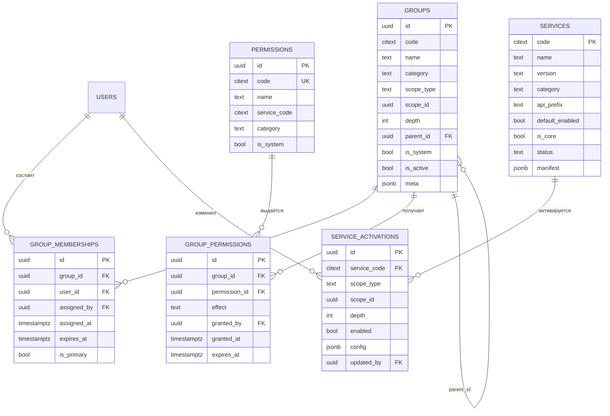

# Модель данных: группы, права и реестр сервисов

| Параметр | Значение |
|---|---|
| Код документа | ШК-04-02 |
| Версия | 1.0 |
| Статус | Рабочий |
| Дата | 30.10.2026 |
| Миграция | `0002_groups_permissions_services` |
| Связанные документы | ШК-04-01, ШК-03-04, ШК-03-05 |

## 1. Назначение

Документ описывает схему хранения иерархических групп, прав и каталога
микросервисов. Схема дополняет ШК-04-01 и не заменяет существующие таблицы.

## 2. ER-диаграмма



## 3. `iam.groups`

| Поле | Тип | Ограничения | Описание |
|---|---|---|---|
| `id` | uuid | PK | Идентификатор |
| `code` | citext | not null | Код внутри области |
| `name` | varchar(255) | not null | Отображаемое имя |
| `description` | text | null | Описание |
| `category` | varchar(32) | not null | Функциональная категория |
| `scope_type` | varchar(16) | not null | `country/region/city/school/class` |
| `scope_id` | uuid | not null | Идентификатор области |
| `depth` | int | 0..4 | Глубина области |
| `parent_id` | uuid | FK `iam.groups.id` | Явный родитель |
| `is_system` | bool | not null | Системная группа |
| `is_active` | bool | not null | Активна |
| `meta` | jsonb | not null | Дополнительные атрибуты |
| `created_at`, `updated_at` | timestamptz | not null | Служебные |

Ограничения и индексы:

- `uq_groups_scope_code` — уникальность `(scope_type, scope_id, code)`;
- `ck_groups_scope_type` — допустимые области;
- `ck_groups_category` — допустимые категории;
- `ck_groups_depth_range` — `depth BETWEEN 0 AND 4`;
- `ix_iam_groups_scope` — `(scope_type, scope_id)`;
- `ix_iam_groups_category` — `category`;
- `ix_groups_parent_id` — `parent_id`.

Страна использует `scope_id = 00000000-0000-0000-0000-000000000000`.
Это позволяет применять уникальные ограничения без NULL-ловушек PostgreSQL.

## 4. `iam.group_memberships`

| Поле | Тип | Ограничения | Описание |
|---|---|---|---|
| `id` | uuid | PK | |
| `group_id` | uuid | FK groups, CASCADE | Группа |
| `user_id` | uuid | FK users, CASCADE | Пользователь |
| `assigned_by` | uuid | FK users, SET NULL | Кто назначил |
| `assigned_at` | timestamptz | not null | Когда |
| `expires_at` | timestamptz | null | Временное членство |
| `is_primary` | bool | not null | Основная группа |

Ограничение `uq_group_memberships_group_user` запрещает дубли.

## 5. `iam.permissions`

| Поле | Тип | Ограничения | Описание |
|---|---|---|---|
| `id` | uuid | PK | |
| `code` | citext | unique | Код вида `journal.grades.write` |
| `name` | varchar(255) | not null | Человекочитаемое имя |
| `description` | text | null | Пояснение |
| `service_code` | citext | not null | Сервис-владелец |
| `category` | varchar(16) | not null | `read/write/admin/use` |
| `is_system` | bool | not null | Системное право |

Индексы: `ix_permissions_code` (unique), `ix_permissions_service_code`.

## 6. `iam.group_permissions`

| Поле | Тип | Ограничения | Описание |
|---|---|---|---|
| `id` | uuid | PK | |
| `group_id` | uuid | FK groups, CASCADE | Группа |
| `permission_id` | uuid | FK permissions, CASCADE | Право |
| `effect` | varchar(8) | `allow/deny` | Эффект |
| `granted_by` | uuid | FK users, SET NULL | Кто выдал |
| `granted_at` | timestamptz | not null | Когда |
| `expires_at` | timestamptz | null | Временное право |

Ограничение `uq_group_permissions_group_permission` запрещает дубли; при
повторной выдаче запись обновляется.

## 7. `system.services`

| Поле | Тип | Ограничения | Описание |
|---|---|---|---|
| `code` | citext | PK | Код сервиса |
| `name` | varchar(255) | not null | Имя |
| `description` | text | null | Описание |
| `version` | varchar(32) | not null | Версия |
| `category` | varchar(32) | not null | Категория |
| `api_prefix` | varchar(64) | not null | Префикс API |
| `icon` | varchar(32) | not null | Иконка |
| `default_enabled` | bool | not null | Включён по умолчанию |
| `is_core` | bool | not null | Ядровый сервис |
| `status` | varchar(16) | not null | `active/beta/disabled` |
| `manifest` | jsonb | not null | Полный манифест |
| `created_at`, `updated_at` | timestamptz | not null | Служебные |

Ограничения: `ck_services_category`, `ck_services_status`.

## 8. `system.service_activations`

| Поле | Тип | Ограничения | Описание |
|---|---|---|---|
| `id` | uuid | PK | |
| `service_code` | citext | FK services, CASCADE | Сервис |
| `scope_type` | varchar(16) | not null | Область |
| `scope_id` | uuid | not null | Идентификатор области |
| `depth` | int | 0..4 | Глубина |
| `enabled` | bool | not null | Включён |
| `config` | jsonb | not null | Параметры области |
| `updated_by` | uuid | FK users, SET NULL | Кто изменил |
| `created_at`, `updated_at` | timestamptz | not null | Служебные |

Ограничение `uq_service_activations_service_scope` — уникальность
`(service_code, scope_type, scope_id)`. Индексы:
`ix_service_activations_service_code`, `ix_system_service_activations_scope`.

## 9. Правила разрешения

### 9.1. Права

```text
effective(user) =
  resolve(
    grants from active memberships
    + explicit parent chain
    + same-category groups at ancestor scopes,
    order by scope depth desc,
    deny before allow on equal depth
  )
```

### 9.2. Сервисы

```text
service_state(user, service) =
  core                    -> enabled
  most specific activation -> activation.enabled
  no activation            -> service.default_enabled
```

## 10. Миграция и seed

- Миграция: `backend/alembic/versions/0002_groups_permissions_services.py`.
- Применение: `alembic upgrade head`.
- Seed: `python -m app.db.seed` создаёт:
  - каталог прав и сервисов;
  - республиканские активации;
  - республиканскую группу администрации;
  - школьные группы всех категорий;
  - классные группы учеников и учителей;
  - членства существующих пользователей по их роли.

## 11. Производительность

- Запрос эффективных прав: 2–4 запроса на пользователя; кеширование в Redis
  вводится на этапе подключения Redis с инвалидацией по изменению группы.
- Индексы по `(scope_type, scope_id)` и `service_code` покрывают выборки.
- Для больших выборок групп используется пагинация.
- Аналитические отчёты не должны выполнять рекурсивный обход на каждый
  запрос: агрегаты считаются фоновыми задачами.

## 12. Безопасность

- Прямые изменения `iam.group_permissions` и `iam.group_memberships` только
  через API с проверкой области и права `iam.groups.write`.
- Аудит изменений обязателен.
- Для критичных таблиц планируется RLS по `school_id`/scope.
- Секреты и ПДн в `meta`/`config` запрещены.
